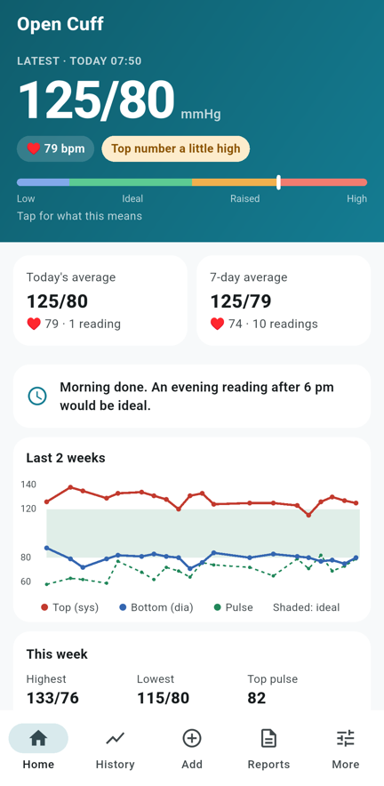
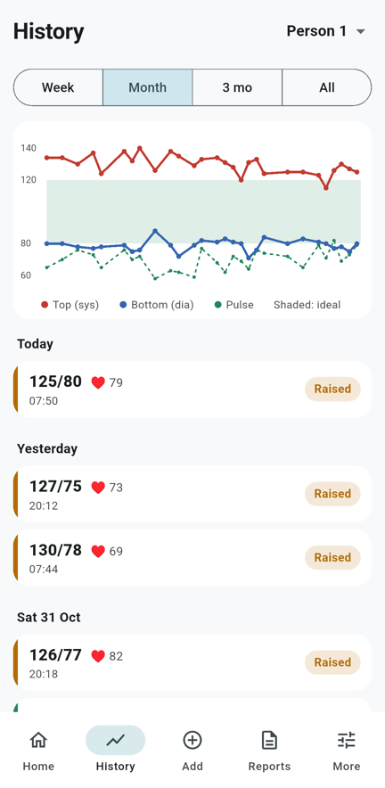
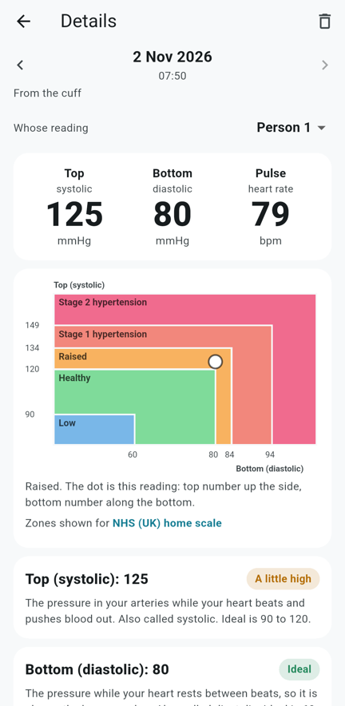
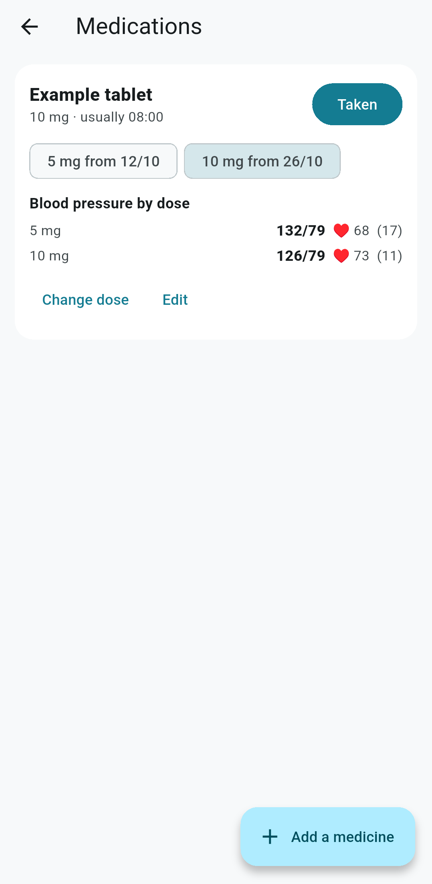

# Open Cuff

A free, open-source blood pressure app and toolkit for Bluetooth cuffs, starting with the **OxiPro BP2 (AOJ-33A)** and the BP2 family. No vendor app, no account, no subscription. Everything a paid "premium" app charges for is built in and optional.

Three parts:

- `app/`: **Open Cuff**, an Android app (Flutter). Syncs the cuff in the background, keeps your history on the phone, explains each reading in plain words with your choice of nine blood pressure scales (NHS, NICE, ESH, ESC, ACC/AHA, ISH, JNC), and can send readings to Health Connect (so Samsung Health and others see them) and Home Assistant. Optional extras, each with its own switch: medicines with blood pressure by dose, the NHS 7-day home check, trend and limit alerts, reminders, doctor PDF / Excel / CSV reports, calm mode, a home screen widget and more. It only ever reads from the cuff and never clears its memory.

- `bp2ble/`: a small Python library and command line tool (uses [bleak](https://github.com/hbldh/bleak), so it runs on Windows, macOS, Linux and a Raspberry Pi).
- `custom_components/bp2_ble/`: a Home Assistant integration. When the monitor switches its Bluetooth on near any Home Assistant Bluetooth adapter or ESPHome Bluetooth proxy, Home Assistant connects, downloads new readings, updates sensors and fires a `bp2_ble_reading` event.

<p>




</p>

<sub>Screenshots use made-up readings.</sub>

## Install the app (Android 8 or newer)

1. On your phone, open the latest [release](https://github.com/Domocn/open-cuff/releases/latest) and download
   `open-cuff-<version>.apk`.
2. Open the file. Android asks once to allow installs from your browser or Files app: allow it, then tap Install.
3. Open Open Cuff and allow **Nearby devices** (and Location on Android 11 or older) so it can find the cuff.
4. Switch the cuff's Bluetooth on (take a reading, or press its Bluetooth button: the left button on the OxiPro BP2). The app finds
   it, pairs and copies the readings already stored on it.
5. Optional, in **More**: background collecting (readings arrive with the app closed), Health Connect (so Samsung
   Health, Google Fit and others see them), Home Assistant, and the extras under **All features**.

Updates: install the newer APK over the top; your readings stay. Before moving phones, use **Reports > Back up**.

Which cuffs work: [docs/compatible-devices.md](docs/compatible-devices.md). Privacy: [PRIVACY.md](PRIVACY.md).

## Install the Home Assistant integration

**HACS:** HACS > three dots > Custom repositories > add `https://github.com/Domocn/open-cuff` as an **Integration**,
then install "BP2 Blood Pressure Monitor (Open Cuff)" and restart Home Assistant.

**By hand:** copy `custom_components/bp2_ble` into your Home Assistant `config/custom_components/` folder and restart.

Then switch the cuff's Bluetooth on near any Home Assistant Bluetooth adapter or ESPHome Bluetooth proxy. Home
Assistant finds it (Settings > Devices & services > Discovered); add it, and each sync updates the sensors and fires a
`bp2_ble_reading` event you can use in automations. `ha_package_bp2_link.yaml` is an example that sends each reading
as a notification.

## Command line

```
pip install bleak
python -m bp2ble scan
python -m bp2ble readings [--json] [--sync-time]
```

Switch the monitor's Bluetooth on first: tap the menu and Start/Stop buttons together.

## Protocol

Commands and replies are framed as `A5 cmd ~cmd type seq len_lo len_hi payload crc8` (CRC-8, polynomial 0x07). The monitor keeps each measurement as a file. `F1` lists files, `F2`/`F3`/`F4` open, read and close one, `EC` sets the clock and `E1` returns device info. A blood pressure file holds the time, systolic, diastolic, mean, pulse and an irregular-pulse flag. See `bp2ble/protocol.py`.

This is an independent implementation based on the publicly documented UUIDs and frame format in the manufacturer's Android demo. It is not affiliated with or endorsed by Viatom, Lepu or OxiPro.

## OxiPro BP2 (AOJ-33A) and other AOJ monitors

These use a different protocol, documented here for interoperability: frames `BE B0 len cmd data crc` out and
`D0 C2 ...` back (CRC-8/MAXIM). The app reads stored readings with `D7 FF 01` and acknowledges each `CC` reading.
See `bp2ble/aoj.py`.

## Compatible devices

See [docs/compatible-devices.md](docs/compatible-devices.md) for which monitors work, which should work, and how to check
yours with a free Bluetooth explorer app. [docs/adding-devices.md](docs/adding-devices.md) explains how a new monitor's
protocol can be added.

## Found a problem?

In the app: **More > Report a problem > Report on GitHub**. It fills in your phone model, the app version and a problem
log with no readings, names, addresses or tokens in it. Or open an issue here.

## Not a medical device

This software only copies numbers the monitor has already measured. Check readings against the monitor's own screen, and follow your clinician's advice. It is not a medical device, it does not diagnose anything, and the NHS home check and trend notes are information only, not medical advice.

## Independent project

Open Cuff is an unofficial, independent project. It is not affiliated with, endorsed by or sponsored by MedM, OxiPro, Shenzhen AOJ Medical, Viatom, Lepu or any other device maker or app. All product names and trademarks belong to their owners and are used only to say which devices this works with.

## How the protocol was worked out

The cuff protocol was worked out for interoperability, so that people can read their own blood pressure data from a monitor they own without a subscription. This repository contains only original code that sends and parses the cuff's Bluetooth messages. It includes no code, assets, firmware, logos or keys from any vendor's app. The app only reads from the cuff and never sends the command that clears its memory. It does not bypass any login, copy protection or access control, and it works only with your own cuff and your own data.

## Use at your own risk

This software is provided as is, under the MIT licence, with no warranty. A manufacturer may change how its cuff talks at any time, which can break syncing. Using it may not be covered by the cuff's warranty or the maker's terms. If a rights holder has a concern about anything here, open an issue and it will be looked at promptly.
